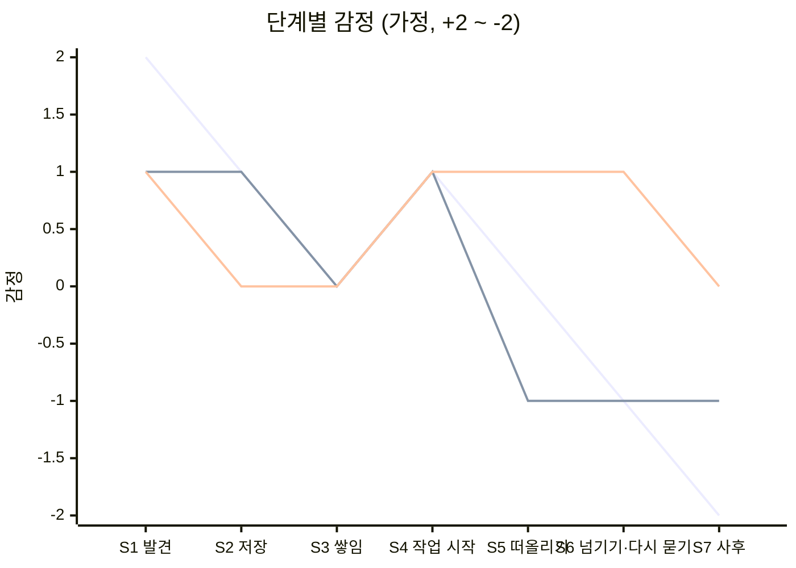

# 사용자 저니맵

작성일 2026-11-25. PO가 서술한 사용자("이것저것 알고 싶고 많은 것을 활용하고 싶은 사람")를 출발점으로, 자료를 발견해서 AI 작업에 쓰기까지의 흐름을 그렸다. 문제와 용어는 [기획 상태 문서](STATE.md)를 따른다. 같은 내용을 발표용 슬라이드로도 만들었다.

> **주의** 세 인물은 모두 가상이다. 인터뷰 전이라 생각·감정 칸은 [가정]이다. 이 문서의 목적은 인터뷰에서 확인할 순간을 고르고, 고정된 솔루션(저장해 아카이브에 모으고 AI 도구에 넘긴다)을 그 순간에 맞춰 구체화하는 것이다.

태그: [근거] 원문을 확인한 자료로 뒷받침 / [가정] 페르소나 설정이나 PO 서술 / [검증] 인터뷰·일지·직접 사용으로 확인해야 함. 감정은 +2(매우 좋음)부터 -2(매우 나쁨)까지다.

## 1. 출발점: PO가 서술한 사용자

- 이것저것 알고 싶은 게 많고, 본 것을 많이 활용하고 싶어 한다.
- 인스타그램, 스레드, 웹 검색에서 본 것 가운데 적용해 보고 싶거나 프로젝트에 쓰고 싶은 것을 저장한다.
- 막상 프로젝트에 적용하거나 Claude에 요청할 때는 저장한 자료를 쓰지 못한다.
- 저장한 자료를 써야겠다는 생각 자체를 잊고, 같은 질문을 다시 하거나 같은 검색을 다시 한다.

마지막 항목이 지금 원인 후보(STATE 6-1 N1~N6)에 없는 원인이다. 자료를 못 찾는 것(N2)이나 넘기기 번거로운 것(N1, N5)보다 앞에서, **떠올리지 못해서** 시도조차 하지 않는다. 이 문서에서는 이를 원인 후보 N7(제안)로 둔다(6절).

## 2. 인물 (가상)

| ID | 인물 | AI 사용 | 저장 수단 | 유형 |
|---|---|---|---|---|
| P-A | 서윤, 29세, 핀테크 스타트업 PM. 주말에 Claude로 뉴스레터 웹사이트를 만들고 있다. 새 AI 도구, 디자인 레퍼런스, 프롬프트 팁을 보면 일단 저장한다 | Claude 대화를 매일 쓴다. AI 코딩 도구는 써 보기 시작했다 | 인스타그램 저장 컬렉션, 스레드 저장, 크롬 북마크, 카톡 나에게 보내기, 사진첩 스크린샷 (5곳) | 입문 사용자, PO 서술의 주인공 |
| P-B | 민재, 33세, 백엔드 개발자. 사이드 프로젝트를 Claude Code로 만든다 | Claude Code를 매일 쓴다. 연결(MCP) 설정을 해 봤다 | GitHub 별표, X·스레드 북마크, Notion, Raindrop (4곳) | 숙련 사용자, 비교용 |
| R-1 | 하린, 30세, 프로덕트 디자이너. 레퍼런스 이미지와 PDF를 Claude 프로젝트에 올려 두고 쓴다 | Claude 프로젝트를 작업별로 만든다 | Claude 프로젝트, 핀터레스트 (2곳) | 반례: AI 도구 안에 이미 모아 둔 사람(STATE 5-1) |

저장 수단을 여러 개 함께 쓴다는 설정은 해외·국내 자료와 맞는다 [근거: E-05 주 1회 이상 평균 약 5가지 보관 방법, E-06 국내 비표본 약 3개 노트 앱 병행]. 개별 인물의 구성은 [가정]이다.

## 3. 공통 단계

모든 인물에 같은 7단계를 쓴다.

| 단계 | 이름 | 무슨 일이 일어나나 |
|---|---|---|
| S1 | 발견 | 피드나 검색에서 쓸 만한 것을 본다 |
| S2 | 저장 | 그 자리에서 손에 닿는 저장 수단에 넣는다 |
| S3 | 쌓임 | 며칠에서 몇 주 동안 다시 열지 않는다 |
| S4 | 작업 시작 | 프로젝트에서 AI 도구에 일을 시키려 한다 |
| S5 | 떠올리기 | 저장해 둔 자료가 생각나는가 (갈림길) |
| S6 | 넘기기 또는 다시 묻기 | 자료를 찾아 넘기거나, 자료 없이 묻거나 다시 검색한다 |
| S7 | 사후 | 결과물에 자료가 반영됐는가, 같은 것을 다시 저장하는가 |

## 4. 인물별 저니맵

### P-A 서윤 (주인공)

| 단계 | 행동 | 접점 | 생각 [가정] | 감정 | 페인포인트 | 근거·검증 |
|---|---|---|---|---|---|---|
| S1 발견 | 출근길에 스레드에서 "Claude로 랜딩페이지 만드는 프롬프트 5개" 글을 보고, 인스타그램에서 뉴스레터 디자인 레퍼런스를 본다 | 스레드, 인스타그램 | "이거 내 뉴스레터 사이트에 딱이다" | +2 | 없음 | [가정] PO 서술 |
| S2 저장 | 스레드 글은 저장, 인스타 게시물은 컬렉션에 저장, 퇴근 후 웹 검색에서 찾은 글은 크롬 북마크. 일부는 스크린샷 | 각 앱의 저장 버튼, 사진첩 | "저장해 뒀으니 나중에 쓰면 되지" | +1 | 저장 위치가 그때그때 다르다. 왜 저장했는지는 남지 않는다 | [근거: E-05, E-06 여러 수단 병행] [가정] 저장 이유가 남지 않음 |
| S3 쌓임 | 2주 동안 열어 보지 않는다. 그 사이 비슷한 글을 몇 개 더 저장한다 | 없음 | (생각하지 않음) | 0 | 저장했다는 사실이 기억에서 흐려진다 | [근거: E-19 해외 36명 전원이 다시 찾는 데 필요한 세부를 잊은 경험] [검증] 국내 대상 |
| S4 작업 시작 | 주말에 Claude를 열고 "뉴스레터 구독 페이지 만들어 줘"라고 쓰기 시작한다 | Claude 대화창 | "오늘은 구독 페이지까지 끝내자" | +1 | 없음 | [가정] |
| S5 떠올리기 | 저장한 프롬프트 글과 디자인 레퍼런스가 떠오르지 않는다 | 없음 | (떠오르지 않으므로 생각도 없음) | 0 | **잊었다는 것을 본인도 모른다.** 이 순간에는 불편이 없다 | [가정] PO 서술 "생각 자체를 잊음" [검증] 일지로만 잴 수 있음 |
| S6 다시 묻기 | 자료 없이 묻는다. 결과가 평범해서 "요즘 뜨는 뉴스레터 디자인"을 다시 검색한다 | Claude, 웹 검색 | "왜 이렇게 밋밋하지" | -1 | 같은 질문, 같은 검색을 반복한다. 결과물에 저장한 자료가 반영되지 않는다 | [가정] PO 서술 [참고: E-18 웹 검색어의 최대 40%가 다시 찾기일 수 있으나 저장한 자료인지는 모름] |
| S7 사후 | 며칠 뒤 인스타 컬렉션을 넘기다 그 레퍼런스를 발견한다. 이미 구독 페이지는 만들었다 | 인스타그램 | "아, 이거 저장해 놨었는데" | -2 | 뒤늦게 알아챈다. 같은 자료를 또 저장하기도 한다 | [가정] [검증] 인터뷰에서 "아차" 사례 수집 |

### P-B 민재 (숙련 사용자, 비교)

| 단계 | 행동 | 접점 | 생각 [가정] | 감정 | 페인포인트 | 근거·검증 |
|---|---|---|---|---|---|---|
| S1 발견 | X에서 인증 라이브러리 비교 글, GitHub에서 예제 저장소를 본다 | X, GitHub | "다음에 인증 붙일 때 참고하자" | +1 | 없음 | [가정] |
| S2 저장 | 글은 Raindrop, 저장소는 GitHub 별표, 짧은 팁은 Notion에 붙여 넣는다 | Raindrop, GitHub, Notion | "태그 달아 뒀으니 찾을 수 있다" | +1 | 자료 종류마다 저장 수단이 다르다 | [근거: E-05] [가정] |
| S3 쌓임 | 한 달 뒤까지 열지 않는다 | 없음 | — | 0 | 없음 | [가정] |
| S4 작업 시작 | Claude Code로 로그인 기능을 붙이기 시작한다 | Claude Code | "인증은 전에 봐 둔 게 있었지" | +1 | 없음 | [가정] |
| S5 떠올리기 | 저장한 건 떠오르지만 어디에 넣었는지 헷갈린다 | Raindrop, Notion 검색 | "Raindrop이었나 Notion이었나" | -1 | 떠올렸지만 찾는 데 시간이 든다(N1, N2) | [근거: E-19 매주 이상 72%] [검증] |
| S6 넘기기 또는 다시 묻기 | 5분 찾다가 포기하고 Claude Code에 "Next.js 인증 라이브러리 추천해 줘"라고 다시 묻는다 | Claude Code | "그냥 물어보는 게 빠르다" | -1 | 저장한 비교 글이 반영되지 않는다 | [가정] [검증] 일지 |
| S7 사후 | Raindrop의 연결(MCP)을 걸어 둘까 생각하지만, 저장 수단마다 따로 연결해야 해서 미룬다 | Raindrop 설정 | "다 연결하기는 귀찮다" | -1 | 연결은 저장 수단마다 따로다 | [근거: 경쟁 서비스 조사, 저장 수단 하나를 AI 도구에 연결하는 서비스 12곳] |

### R-1 하린 (반례: AI 도구 안에 이미 모아 둔 사람)

| 단계 | 행동 | 접점 | 생각 [가정] | 감정 | 페인포인트 | 근거·검증 |
|---|---|---|---|---|---|---|
| S1 발견 | 핀터레스트와 디자인 블로그에서 온보딩 화면 레퍼런스를 본다 | 핀터레스트, 웹 | "이번 온보딩 개편에 쓰자" | +1 | 없음 | [가정] |
| S2 저장 | 이미지를 내려받아 작업별 Claude 프로젝트에 바로 올린다 | Claude 프로젝트 | "작업할 때 여기서 바로 쓴다" | 0 | 올리는 수고가 저장 때 든다 | [근거: Claude 프로젝트 기능 존재, 경쟁 서비스 조사] [가정] |
| S3 쌓임 | 프로젝트 안에 자료가 쌓인다 | Claude 프로젝트 | — | 0 | 없음 | [가정] |
| S4 작업 시작 | 그 프로젝트를 열고 대화를 시작한다 | Claude 프로젝트 | — | +1 | 없음 | [가정] |
| S5 떠올리기 | 떠올릴 필요가 없다. 자료가 이미 프로젝트에 있다 | Claude 프로젝트 | — | +1 | 없음 | [가정] |
| S6 넘기기 | 따로 넘기지 않아도 Claude가 자료를 읽는다 | Claude | "레퍼런스 반영이 잘 된다" | +1 | 다른 AI 도구(예: 다른 회사 도구)로 옮기면 다시 올려야 한다(N5) | [근거: 다른 회사 AI 도구로 내보내는 기능을 찾지 못함, 경쟁 서비스 조사] |
| S7 사후 | 프로젝트 밖에서 저장한 것(핀터레스트 보드)은 여전히 쓰이지 않는다 | 핀터레스트 | — | 0 | 미리 올려 둔 것만 쓰인다 | [검증] 이런 사람이 얼마나 되는지 |

R-1은 S5의 "잊음"을 구조로 피한다. 작업 공간과 저장 공간이 같기 때문이다. 이 반례가 많으면 STATE 5-1 반증 조건 3에 걸린다.

## 5. 감정 곡선

선 순서: P-A 서윤, P-B 민재, R-1 하린.

읽는 법: 서윤의 감정은 S5에서 떨어지지 않는다. 잊었기 때문에 불편을 느끼지 못하고, 손해는 S7에 뒤늦게 온다. 민재는 S5에서 이미 떨어진다(떠올렸지만 찾지 못함). 하린은 저장 때(S2) 수고를 먼저 치르고 뒤에서 편하다.

## 6. 비교표

| 구분 | P-A 서윤 | P-B 민재 | R-1 하린 |
|---|---|---|---|
| 저장하는 계기 | 호기심. "언젠가 써 보고 싶다" | 다음 작업에 쓸 참고 | 지금 하는 작업 |
| 저장 수단과 작업 공간의 거리 | 멀다(소셜 앱 ↔ Claude) | 중간(개발 도구 ↔ Claude Code) | 같다(Claude 프로젝트) |
| S5에서 무슨 일이 생기나 | 떠오르지 않는다 (N7 제안) | 떠오르지만 어디 있는지 모른다 (N1, N2) | 떠올릴 필요가 없다 |
| 실패를 누가 아는가 | 아무도 모른다. 본인도 나중에 우연히 안다 | 본인이 그 자리에서 안다 | 해당 없음 |
| 손실 형태 | 같은 질문·같은 검색 반복, 결과물이 평범해짐, 같은 자료 다시 저장 | 찾는 시간, 결국 자료 없이 질문 | 저장할 때 올리는 수고, 다른 AI 도구로 옮기면 다시 올림 |
| 지금 해결책으로 충분한가 | 아니다. 떠올려야 쓰는 방식(명령어로 고르기)만으로는 시작이 안 된다 | 명령어로 찾아 넘기기가 맞다 | 대체로 충분하다. 다른 AI 도구로 옮길 때만 약하다 |

## 7. 원인 후보 N7 (제안)

| ID | 가설 | 근거 | 반증 조건 |
|---|---|---|---|
| N7 (제안) | AI 작업을 시작할 때 저장해 둔 관련 자료가 있다는 것이 떠오르지 않아, 넘기려는 시도 자체가 일어나지 않는다 | PO 서술 [가정]. 가장 가까운 것은 E-19(세부를 잊음)이나 이는 "어디 있는지·무엇인지"를 잊는 것이고 "있다는 것"을 잊는 것과 다르다 | 일지에서 "관련 자료가 있었는데 넣지 않고 물은" 작업 가운데, 자료가 있다는 것을 그때 떠올렸던 경우가 과반 (이 경우 N7이 아니라 N1·N2·N5가 원인) |

STATE 5-1 N2-2("저장한 걸 아예 잊는 것이 주된 문제")와 겹친다. N2-2는 다시 찾기 문제의 반증 조건이었고, 지금 문제 정의(넘기기)에서는 "잊음"이 반증이 아니라 원인 후보가 된다. 주의할 점이 하나 있다. 이전 결정 로그에 따르면 PO는 해결 방향을 솔루션 밖(일반적인 재노출 기능)으로 넓히는 것을 되돌렸다. 아래 8절의 해결안은 모두 "AI 작업을 하는 순간에 넘기기를 돕는다"는 고정 솔루션 안에 둔다.

측정 주의: 서윤 유형은 잊은 것을 본인도 모르므로 인터뷰 자기보고로는 잘 잡히지 않는다. 일지(AI 작업마다 "관련 저장 자료가 있었는가"를 작업 뒤에 저장 수단을 훑어 확인)가 주 방법이다.

## 8. 결정적 순간과 솔루션 구체화

결정적 순간은 감정이나 행동이 갈리는 곳이고, 솔루션이 개입할 지점이다. 기능 ID는 [기획서](PRD.md) 7절을 따르고, 새 후보는 (제안)이다.

| 순간 | 지금 (가정) | 이 서비스가 하는 일 | 기능 | 상태 |
|---|---|---|---|---|
| M1 저장 순간 (S2) | 앱마다 다른 곳에 저장되고 왜 저장했는지 안 남는다 | 인스타그램·스레드·브라우저의 공유 한 번으로 한 아카이브에 저장한다. 본문을 가져와 요약과 자동 태그를 만든다 | F1, F2 | PRD에 있음. [검증] 인스타그램·스레드 게시물은 로그인 없이 본문을 가져오지 못할 수 있다(N3). 스크린샷 글자 읽기(F16)의 비중이 커진다. 개발자 확인 |
| M2 작업 시작 순간 (S4→S5) | 떠오르지 않는다 (N7) | (안 1) 연결(MCP): Claude가 작업 중에 아카이브를 먼저 찾아본다. 사용자가 잊어도 동작한다 | F7 | PRD P1. N7이 맞다면 우선순위를 다시 볼 이유가 된다 |
| | | (안 2) 작업 시작 명령: 터미널 화면에서 `start 뉴스레터`처럼 작업 이름을 치면 관련 자료를 모아 보여 주고 넘길 글을 만든다 | F20 (제안) | 새 후보. 서비스를 열어야 동작하므로 "잊음"을 완전히 풀지는 못한다 |
| | | (안 3) AI 도구 입력창 옆 제안: 입력하는 내용과 관련된 저장 자료를 옆에 띄우고 한 번에 넣는다 | F11 | PRD 이후 단계. 가장 직접적이지만 Supermemory·MemoryPlugin 확장과 겹친다(공백 17) |
| M3 다시 검색·다시 저장 순간 (S6, S7) | 같은 것을 또 검색하고 또 저장한다 | 같거나 비슷한 자료를 다시 저장하면 "이미 저장한 자료가 있어요"와 함께 관련 자료를 보여 주고, 바로 넘길 글로 만들 수 있게 한다 | F21 (제안) | 새 후보. F1의 중복 처리(같은 링크는 새로 만들지 않음)를 넓힌 것 |
| M4 대화나 AI 도구가 바뀌는 순간 | 같은 자료를 다시 넣는다(N5) | 이름 붙인 묶음을 한 줄로 다시 넘긴다. 연결해 둔 도구에서는 다시 넣지 않는다 | F12, F7 | PRD에 있음 |

차별점과의 관계: 포지셔닝은 "AI가 알아서 찾아 읽는 연결형과 달리, 사용자가 명령어로 직접 골라 묶어 넘긴다"이다. 서윤 유형에게는 직접 고르기만으로는 시작이 일어나지 않는다. 그래서 다음처럼 역할을 나누는 안을 제안한다(PO 판단 필요):

- 명령어로 골라 넘기기: 떠올렸을 때 정확하게 넘기는 주 경로 (민재 유형)
- 연결(안 1)과 다시 저장 알림(M3): 잊었을 때 받쳐 주는 안전망 (서윤 유형)

### 바뀐 뒤의 서윤 (To-be, 가정)

| 단계 | 바뀐 뒤 | 감정 [가정] |
|---|---|---|
| S2 저장 | 스레드·인스타그램에서 공유 → 이 서비스. 어디에 저장했는지 고민하지 않는다 | +1 |
| S4 작업 시작 | Claude에 "구독 페이지 만들어 줘"라고 쓴다 | +1 |
| S5 떠올리기 | (연결한 경우) Claude가 아카이브에서 "뉴스레터 디자인 레퍼런스 3개, 랜딩페이지 프롬프트 글 1개"를 찾아 쓴다. (연결하지 않은 경우) 터미널 화면에서 `grep 뉴스레터 \| copy`로 넘길 글을 만들어 붙여 넣는다 | +1 |
| S6 넘기기 | 결과물에 저장한 레퍼런스가 반영된다 | +2 |
| S7 사후 | 같은 레퍼런스를 다시 저장하려 하면 이미 있다고 알려 준다 | +1 |

## 9. 인터뷰·일지에서 확인할 것

1. 최근 AI 작업 가운데 "나중에 보니 관련 자료를 저장해 뒀던" 사례가 있는가 (N7, 서윤 유형)
2. 그 자료를 작업 중에 떠올렸는가, 떠올렸지만 못 찾았는가, 찾았지만 넣기 번거로웠는가 (N7 대 N1·N2·N5 구분)
3. 인스타그램·스레드에서 저장한 것 가운데 AI 작업에 쓰려던 것의 비중 (공백 14)
4. 같은 것을 다시 검색하거나 다시 저장한 경험과 빈도 (M3)
5. Claude가 알아서 아카이브를 찾아 쓰는 것과 직접 골라 넘기는 것 가운데 무엇을 원하는가 (공백 17)
6. 작업과 저장을 한 곳(Claude 프로젝트 등)에서 하는 사람이 얼마나 되는가 (R-1, 반증 조건 3)

## 10. 객관성의 한계

- 세 인물은 가상이다. 서윤은 PO 서술을, 민재와 하린은 기획 에이전트의 설정을 바탕으로 했다.
- 생각·감정은 모두 [가정]이고, 감정 점수는 상대 비교용이다.
- 인스타그램·스레드 저장 행동, 국내 AI 활용자의 저장 행동은 근거가 없다(STATE 13절 공백 4, 9, 14).
- 세 인물 모두 Claude 사용자로 그렸다. 다른 AI 도구 사용자는 다를 수 있다.
- 주인공 저니가 실패로 끝나도록 그렸으므로, 반례 R-1을 함께 두었다. 서윤 유형이 실제로 얼마나 되는지는 모른다.

## 11. PO 판단이 필요한 것

| 번호 | 항목 | 왜 |
|---|---|---|
| 1 | N7(떠올리지 못함)을 원인 후보로 STATE에 올릴지 | PO 서술에서 나왔고 근거는 없다 |
| 2 | M2 작업 시작 순간의 해결안(안 1 연결, 안 2 작업 시작 명령, 안 3 입력창 옆 제안) 가운데 무엇을 MVP 후보로 개발자에게 넘길지 | 범위는 개발자가 정하지만 방향은 PO가 정한다 |
| 3 | 명령어로 고르기를 주 경로, 연결·다시 저장 알림을 안전망으로 두는 역할 나눔 | 포지셔닝 문장("연결형과 달리")과 부딪힐 수 있다 |
| 4 | F20(작업 시작 명령), F21(다시 저장할 때 관련 자료 알림)을 기획서 범위 표에 넣을지 | 새 후보 |
